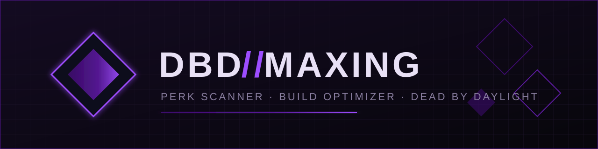
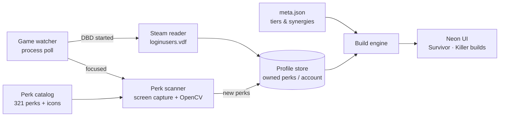

<p align="center">
  
</p>

<p align="center">
  <a href="https://github.com/Tymex321/DbdMaxing/actions/workflows/build.yml"></a>
  <a href="https://github.com/Tymex321/DbdMaxing/releases/latest"></a>
  
  
  
  <a href="LICENSE"></a>
</p>

<p align="center">
  <b>Your Dead by Daylight perks, scanned automatically. The best builds you can actually run.</b><br>
  <sub>A Windows tray app that watches for DBD, learns which perks your account owns, and ranks the strongest survivor and killer loadouts.</sub>
</p>

<p align="center">
  <a href="#-download">Download</a> ·
  <a href="#-features">Features</a> ·
  <a href="#-how-it-works">How it works</a> ·
  <a href="#-anti-cheat-safety">Anti-cheat</a> ·
  <a href="#-tier-list">Tier list</a> ·
  <a href="#-development">Development</a>
</p>

---

## ✨ Features

| | |
| --- | --- |
| 🎮 **Auto game detection** | Notices DBD starting and stopping, and sends a tray notification |
| 👤 **Steam account aware** | Picks up the logged-in Steam account with no login or API key, and keeps perks separate for each account |
| 🔍 **Perk scanner** | Recognises perk icons on your loadout screen with OpenCV template matching |
| 🧠 **Build optimizer** | Scores every 4-perk combination using tiers, synergies (Pentimento + Undying), anti-synergies and redundancy penalties |
| 🔪 **Killer tuning** | Re-ranks builds for the killer you pick (Blight, Nurse, Huntress…) |
| 🔒 **Anti-cheat safe** | Screenshots only: no memory reading, no injection, no packet sniffing |
| 🌌 **Neon UI** | A borderless black and dark-purple interface with glowing perk diamonds |
| 📝 **Editable tier list** | Plain JSON with optional per-user overrides |

## 📥 Download

1. Grab `DbdMaxing.exe` from the [**latest release**](https://github.com/Tymex321/DbdMaxing/releases/latest). Or use the newest successful [Actions build](https://github.com/Tymex321/DbdMaxing/actions/workflows/build.yml) and download the **DbdMaxing-win-x64** artifact.
2. Run it. It's a single self-contained exe, so you don't need to install .NET.
3. Start Dead by Daylight, open **Loadout → Perks**, and scroll through your perks once for each role.

> [!NOTE]
> Windows SmartScreen may warn you because the exe isn't code-signed yet. Click **More info → Run anyway**.

> [!IMPORTANT]
> Set DBD's **Display mode** to **Borderless** or **Windowed**. Exclusive fullscreen usually returns black screenshots.

## 🔧 How it works



| Step | What happens |
| --- | --- |
| Game detection | Every 2 seconds, the app checks whether `DeadByDaylight-Win64-Shipping.exe` is running. You get a tray notification when it starts. |
| Account | The app reads the most recent Steam login from Steam's `config/loginusers.vdf`. It needs no login or API key. Owned perks are stored separately for each Steam account. |
| Perk scan | While DBD is the focused window, the app takes a screenshot every ~1.5 s and matches it against every perk icon. Any perk it sees on your loadout or bloodweb screen is saved as owned. |
| DLC hint | DLC that Steam has installed as depots is detected from the local app manifest. This is best-effort, because most DBD chapters are licence-only. |
| Manual fix | On the **My Perks** page you can tick or untick any perk. Unticking a perk stops the scanner from adding it back. |
| Builds | The build engine scores every 4-perk combination of your owned perks. The score comes from perk tier ratings, synergies (for example Pentimento + Undying), and penalties for redundancy (for example two exhaustion perks). Killer builds can be tuned for a specific killer. |

### First-time setup in game

1. In DBD's graphics settings, set **Display mode** to **Borderless** or **Windowed**. Exclusive fullscreen often returns black screenshots.
2. Open the **Loadout → Perks** screen as a survivor and scroll through the whole perk list. Then do the same as a killer.
3. Watch the **Scanner** panel in the app. It shows `+N new: …` as perks are recognised.

## 🔒 Anti-cheat safety

DbdMaxing **only takes screenshots** of the game window, the same way OBS or Discord does. It never opens the game process, reads or writes memory, injects code, or touches network traffic, so there is nothing for Easy Anti-Cheat to flag.

## 💾 Data

Everything is stored in `%AppData%\DbdMaxing`:

- `profiles/<steamid>.json`: the owned perks for each account
- `cache/catalog.json` and `cache/icons/`: the perk database and icons. They're downloaded from the public [dbd.tricky.lol](https://dbd.tricky.lol) API and refreshed every few days.
- `settings.json` and `dbdmaxing.log`. Attach the log when you report bugs.
- `meta.override.json` (optional): your own tier list. It has the same format as [`src/DbdMaxing.Core/Data/meta.json`](src/DbdMaxing.Core/Data/meta.json).

## 📈 Tier list

The build rankings live in [`src/DbdMaxing.Core/Data/meta.json`](src/DbdMaxing.Core/Data/meta.json):

- `perks`: a score from 0 to 10 for each perk id, plus optional per-killer bonuses.
- `synergies`: pairs of perks that work well (positive bonus) or badly (negative bonus) together.
- `tagLimits`: caps such as "at most 1 exhaustion perk".
- `archetypes`: names given to builds, such as *Gen Slowdown* or *Anti-Tunnel*.

Perk ids are the lower-case, hyphenated perk names (for example `barbecue-chili`). After a DBD patch, edit this file and push. CI builds a new exe.

## 🧰 Development

The project needs the .NET 8 SDK. The solution builds on macOS and Linux as well, because `EnableWindowsTargeting` is set, but the app only runs on Windows.

```
dotnet build DbdMaxing.sln
dotnet test tests/DbdMaxing.Core.Tests
dotnet publish src/DbdMaxing.App -c Release -r win-x64 --self-contained -p:PublishSingleFile=true
```

| Project | Purpose |
| --- | --- |
| `src/DbdMaxing.Core` | Models, perk catalog, meta tier list, build engine, Steam reader, profile storage, game watcher. Cross-platform and unit-tested. |
| `src/DbdMaxing.Vision` | Window capture (GDI) and OpenCV perk-icon matching. Windows only. |
| `src/DbdMaxing.App` | WPF UI (`Themes/Neon.xaml`), tray icon, wiring |
| `tests/DbdMaxing.Core.Tests` | xUnit tests |

Fonts: [Orbitron](https://fonts.google.com/specimen/Orbitron) and [Inter](https://fonts.google.com/specimen/Inter), both under the SIL Open Font License.


## 🤝 Contributing

Tier-list tweaks, scanner screenshots and bug reports are all welcome. See [CONTRIBUTING.md](CONTRIBUTING.md) to get started, and [SECURITY.md](SECURITY.md) for the anti-cheat policy.

---

<sub>DbdMaxing is a fan project and is not affiliated with Behaviour Interactive. Dead by Daylight and its perk art belong to Behaviour Interactive. Perk icons are downloaded at runtime and are not stored in this repository.</sub>
